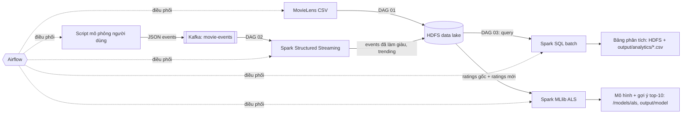

# Đồ án Big Data: Hệ thống phân tích & gợi ý phim theo thời gian thực

**HDFS · Kafka · Spark (Batch + Structured Streaming + MLlib) · Airflow** chạy hoàn toàn bằng Docker.

Bộ dữ liệu: **MovieLens ml-latest-small** (GroupLens) gồm khoảng 100.000 lượt đánh giá, 9.700 phim, 610 người dùng.
Script `scripts/download_dataset.py` (được DAG 01 gọi) tự tải bộ dữ liệu về.

---

## 1. Kiến trúc

```
                    ┌──────────────────────── Apache Airflow (điều phối các luồng) ───────────────────────┐
                    │  DAG 01: ingest          DAG 02: streaming                 DAG 03: batch + ML        │
                    └─────┬───────────────────────┬───────────────────────────────────┬────────────────────┘
                          │                       │                                   │
  MovieLens CSV ──────────▼                       ▼                                   ▼
  (dữ liệu gốc)      ┌─────────┐   query   ┌──────────────┐   phân tích (Spark SQL) ──► bảng kết quả (HDFS + CSV)
                     │  HDFS   │──────────►│ Spark batch  │
                     │ (data   │           └──────────────┘   huấn luyện mô hình ALS ─► /models/als (gợi ý phim)
                     │  lake)  │◄─────────────────┐
                     └─────────┘                  │ ghi sự kiện đã làm giàu (Parquet)
                                                  │
  Script sinh dữ liệu ──► Kafka topic ──► Spark Structured Streaming ──► trending theo cửa sổ 1 phút
  (mô phỏng người dùng)   movie-events     (parse JSON + join danh mục phim)
```



**Ý tưởng chính:** dữ liệu gốc được lưu ở HDFS. Một script liên tục sinh ra hành vi người dùng
(xem phim, xem trailer, thêm vào danh sách, xem hết, chấm điểm). Kafka hứng các sự kiện này, Spark Streaming
xử lý và **làm giàu** chúng rồi ghi lại vào HDFS. Spark batch truy vấn tất cả dữ liệu (gốc + mới) để
phân tích và **huấn luyện lại mô hình gợi ý**. Airflow điều phối toàn bộ các luồng.

### Bố cục dữ liệu trên HDFS

| Đường dẫn HDFS | Nội dung |
|---|---|
| `/datalake/raw/movielens/` | ratings.csv, movies.csv, tags.csv, links.csv (dữ liệu gốc) |
| `/datalake/streaming/events/` | sự kiện người dùng đã làm giàu, Parquet, phân vùng theo `event_date` |
| `/datalake/streaming/trending/` | thống kê phim theo cửa sổ 1 phút |
| `/datalake/curated/ratings_all/` | ratings gốc + ratings mới từ streaming (cột `source`) |
| `/datalake/analytics/<bảng>/` | các bảng kết quả phân tích |
| `/models/als/latest`, `/models/als/<phiên bản>` | mô hình gợi ý ALS |

---

## 2. Cấu trúc thư mục

```
DoAnTH_BigData/
├── docker-compose.yml            # toàn bộ cụm: HDFS, Kafka, Spark, Airflow, Postgres, Kafka UI
├── hadoop.env                    # cấu hình HDFS
├── docker/
│   ├── spark/Dockerfile          # Spark 3.5.1 + numpy + connector Kafka
│   └── airflow/Dockerfile        # Airflow 2.9.3 + docker CLI + kafka-python
├── airflow/dags/
│   ├── dag_00_full_pipeline.py   # chạy cả pipeline 01 → 02 → 03
│   ├── dag_01_ingest_hdfs.py     # tải dữ liệu → HDFS
│   ├── dag_02_streaming.py       # script sinh dữ liệu → Kafka → Spark Streaming → HDFS
│   ├── dag_03_batch_ml.py        # Spark SQL phân tích + huấn luyện ALS
│   └── pipeline_common.py
├── scripts/
│   ├── download_dataset.py       # tải MovieLens
│   └── user_activity_generator.py# script làm giàu dữ liệu liên tục (mô phỏng người dùng)
├── spark_jobs/
│   ├── streaming_events.py       # Spark Structured Streaming
│   ├── batch_analytics.py        # Spark SQL batch
│   └── train_model.py            # Spark MLlib ALS
├── data/                         # dữ liệu tải về (tự sinh)
├── output/                       # kết quả: analytics/*.csv, model/metrics.json ...
└── docs/BAO_CAO.md               # khung báo cáo
```

---

## 3. Yêu cầu

- **Docker Desktop** (Windows dùng WSL2), cấp cho Docker **tối thiểu 6 GB RAM** (khuyến nghị 8 GB):
  Docker Desktop → Settings → Resources.
- Có kết nối Internet ở lần chạy đầu (tải image Docker và bộ dữ liệu).
- Các cổng còn trống: 8080, 8081, 8085, 8088, 9870, 9864, 9000, 7077, 4040, 4041, 29092.

---

## 4. Cách chạy

### Bước 1: Khởi động cụm

```powershell
cd "D:\DH\BigData\Thực Hành\DoAnTH_BigData"
docker compose up -d --build
docker compose ps          # đợi khoảng 1-2 phút cho tất cả container lên
```

| Giao diện | Địa chỉ | Ghi chú |
|---|---|---|
| **Trang web CineData** | http://localhost:8550 | realtime từ Kafka, phân tích, hành vi người dùng, gợi ý phim, tìm phim, trạng thái hệ thống |
| Airflow | http://localhost:8088 | tài khoản **admin / admin** |
| HDFS NameNode | http://localhost:9870 | Utilities → Browse the file system |
| Spark Master | http://localhost:8080 | xem worker, ứng dụng đang chạy |
| Spark job đang chạy | http://localhost:4040 (job thứ hai chạy cùng lúc dùng 4041) | tab *Structured Streaming* |
| Kafka UI | http://localhost:8085 | xem topic `movie-events`, message |

### Bước 2: Chạy pipeline bằng Airflow

Vào Airflow → DAG **`00_full_pipeline`** → nút ▶ *Trigger DAG*. DAG này lần lượt chạy:

1. **`01_ingest_movielens_to_hdfs`**: tải dữ liệu, tạo thư mục và `hdfs dfs -put` lên HDFS.
2. **`02_streaming_user_events`**: tạo topic Kafka, sau đó **song song**:
   Spark Streaming đọc Kafka và ghi HDFS, còn script mô phỏng người dùng bắn sự kiện vào Kafka (mặc định 180 giây, 10 sự kiện/giây).
3. **`03_batch_analytics_and_ml`**: Spark SQL truy vấn HDFS để phân tích, sau đó huấn luyện mô hình ALS.

Cũng có thể chạy từng DAG riêng. DAG 02 cho phép chỉnh `duration_seconds` và `events_per_second`
qua *Trigger DAG w/ config*. Chạy DAG 02 nhiều lần, sau đó chạy DAG 03 sẽ thấy số ratings từ nguồn `streaming`
tăng dần và mô hình được huấn luyện lại trên dữ liệu đã làm giàu (xem `output/model/training_history.csv`).

### Bước 3: Xem kết quả

- `output/analytics/*.csv`: top phim, thống kê thể loại, theo thập niên, phân bố điểm, hành vi người dùng streaming...
- `output/model/metrics.json`: RMSE/MAE của mô hình, kết quả grid search.
- `output/model/sample_recommendations.csv`: top-10 phim gợi ý cho một số người dùng.
- Trên HDFS: http://localhost:9870 → `/datalake/...`, `/models/als/...`

---

## 5. Chạy thủ công (không qua Airflow), tiện để demo từng phần

```powershell
# HDFS
docker exec bd-namenode hdfs dfs -ls -R /datalake

# Script sinh dữ liệu chạy LIÊN TỤC (Ctrl+C để dừng)
docker exec -it bd-airflow python /opt/airflow/scripts/user_activity_generator.py --bootstrap kafka:9092 --rate 5
#   hoặc chạy trên máy Windows:  pip install "kafka-python>=2.0.3"
#   python scripts/user_activity_generator.py --bootstrap localhost:29092 --data-dir data/movielens

# Xem message trong Kafka
docker exec -it bd-kafka /opt/kafka/bin/kafka-console-consumer.sh --bootstrap-server kafka:9092 --topic movie-events

# Spark Streaming chạy liên tục (mở terminal khác)
docker exec -it -u root bd-spark-master spark-submit --master spark://spark-master:7077 --total-executor-cores 1 --executor-memory 900m /opt/spark-apps/streaming_events.py

# Spark batch + ML
docker exec -it -u root bd-spark-master spark-submit --master spark://spark-master:7077 --executor-memory 900m /opt/spark-apps/batch_analytics.py
docker exec -it -u root bd-spark-master spark-submit --master spark://spark-master:7077 --executor-memory 900m /opt/spark-apps/train_model.py
```

---

## 6. Dừng / dọn dẹp

```powershell
docker compose down        # dừng, GIỮ dữ liệu HDFS/Kafka (volume)
docker compose down -v     # dừng và XOÁ toàn bộ dữ liệu
```

## 7. Lỗi thường gặp

| Hiện tượng | Cách xử lý |
|---|---|
| Task Airflow báo `permission denied ... docker.sock` | Docker Desktop → Settings → General: bật *Use the WSL 2 based engine*; khởi động lại Docker. |
| Spark job treo ở `Initial job has not accepted any resources` | Một job khác đang giữ hết core. Đợi job đó xong, hoặc tăng `SPARK_WORKER_CORES` / `SPARK_WORKER_MEMORY` trong `docker-compose.yml`. |
| `download_dataset` lỗi mạng | Tải thủ công https://files.grouplens.org/datasets/movielens/ml-latest-small.zip, giải nén 4 file csv vào `data/movielens/`. |
| Container bị tắt (exit 137) | Thiếu RAM: tăng RAM cho Docker Desktop. |
| Muốn chạy lại streaming từ đầu | `docker exec bd-namenode hdfs dfs -rm -r -f /datalake/streaming` |
